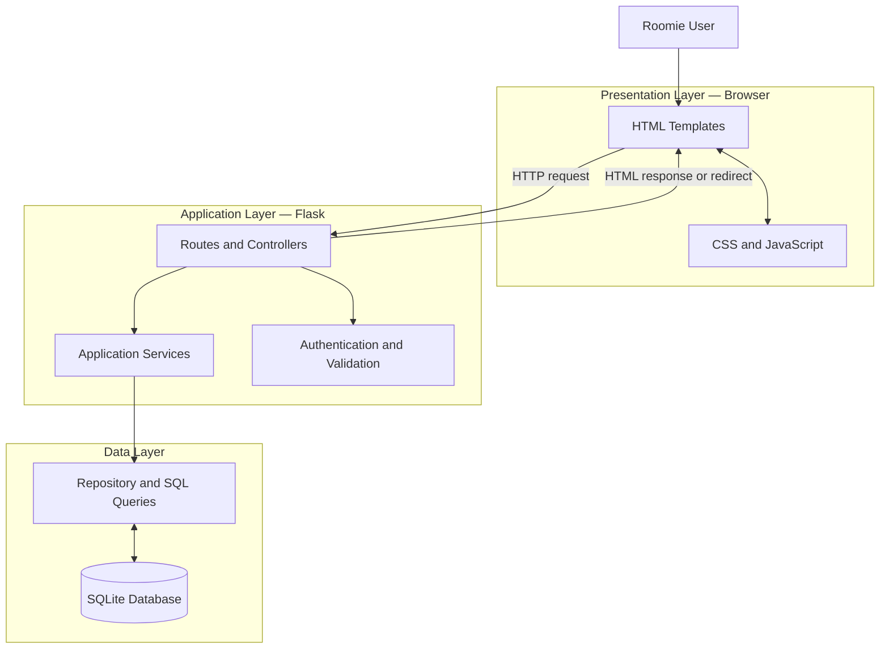
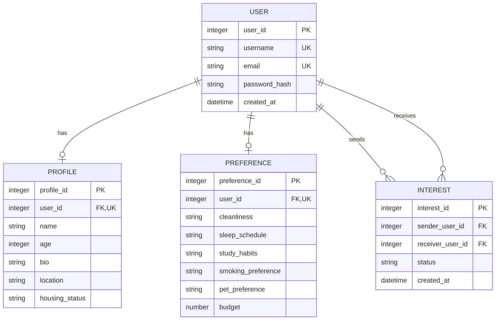
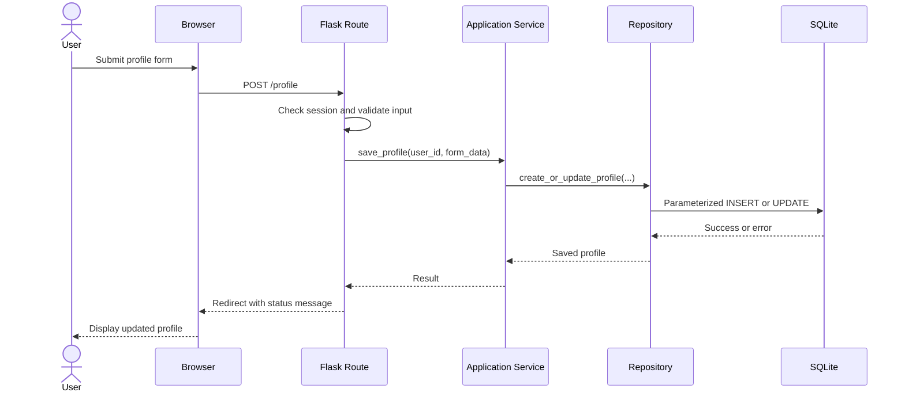
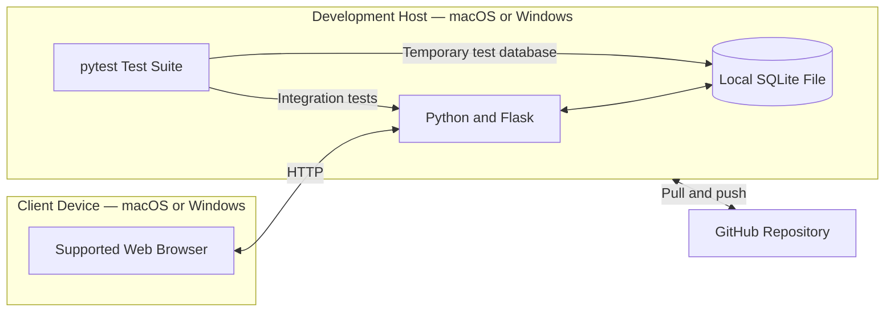

# Roomie Architecture and Design

## 1. Purpose and Scope

This document begins the implementation and design section of the Roomie project document. The architecture supports the semester MVP defined in `docs/requirements.md`: account access, roommate profiles, preferences, roommate discovery, profile viewing, and interest management. Room listings, messaging, payments, identity verification, and advanced matching remain outside the MVP.

## 2. Design Approach

Roomie will use a layered web-application architecture. The browser presents the interface and sends HTTP requests to a Flask application. Flask routes coordinate application services, validation, authentication, and database access. SQLite stores account, profile, preference, and interest data.

The layers separate presentation, application logic, and persistence so that each part can be developed and tested independently. The team will implement the shortest complete user workflow first and add optional features only after the MVP works reliably.

## 3. Architecture Sketch

**Diagram type: Component diagram**  
**Owner: Swikar — UI/UX and Frontend**

### Component Responsibilities

| Component | Important responsibilities |
| --- | --- |
| HTML templates | Display registration, login, profile, preference, match, and interest pages. |
| CSS and JavaScript | Provide responsive styling, client-side interaction, and visible feedback without replacing server validation. |
| Flask routes/controllers | Receive requests, enforce access rules, call services, and return templates or redirects. |
| Authentication and validation | Verify sessions, hash/check passwords, validate input, and reject unauthorized requests. |
| Application services | Coordinate account, profile, preference, matching, and interest use cases. |
| Repository/data access | Execute parameterized SQL and convert database rows into application objects. |
| SQLite database | Persist users, profiles, preferences, and interests while enforcing constraints. |

## 4. Major Implementation Units

| Unit | Important data | Important functions or methods | Interactions |
| --- | --- | --- | --- |
| User | user_id, username, email, password_hash, created_at | create_user(), find_by_email(), verify_password() | Authentication, Profile, Preference, Interest |
| Profile | profile_id, user_id, name, age, bio, location, housing_status | create_profile(), update_profile(), get_profile() | User, matching service |
| Preference | preference_id, user_id, cleanliness, sleep_schedule, study_habits, smoking_preference, pet_preference, budget | save_preferences(), get_preferences() | User, matching service |
| Interest | interest_id, sender_user_id, receiver_user_id, status, created_at | set_interest(), change_interest(), remove_interest() | User, profile display |
| AuthService | Session and credential state | register(), login(), logout(), require_login() | User repository, Flask routes |
| MatchService | Filters and candidate profiles | find_matches(), exclude_current_user() | Profile and Preference repositories |
| InterestService | Sender, receiver, and status | record_interest(), update_interest(), remove_interest() | Interest repository, authentication |
| Database | Connection and transaction state | get_connection(), initialize_schema(), commit(), rollback() | All repositories |

The names may change during implementation, but their responsibilities should remain separated.

## 5. Supporting Diagram Assignments

Each member must create or substantially edit at least one design/modeling diagram. The initial assignments are:

| Member | Diagram | Required content | Repository location |
| --- | --- | --- | --- |
| Swikar | Component diagram | Browser, Flask application, SQLite, and major data/control flow | Section 3 of this document |
| Stuti | Entity-relationship diagram | User, Profile, Preference, Interest, keys, and cardinalities | Section 6 |
| Arpan | Sequence diagram | Register/login or profile-save request through routes, services, and SQLite | Section 7 |
| Rajju | Deployment/integration diagram | Browser, Flask server, SQLite file, supported operating systems, and test boundary | Section 8 |

Every owner should check the existing draft, correct it to match their work, and commit the edit on a personal branch. That edit is the member's diagram contribution.

## 6. Data Model Draft

**Diagram type: Entity-relationship diagram**  
**Owner: Stuti — Database**

Stuti should compare this diagram with `docs/database-design.md`, correct field names or constraints if the schema changes, and confirm the no-self-interest rule.

## 7. Backend Interaction Draft

**Diagram type: UML sequence diagram**  
**Owner: Arpan — Backend**

Arpan should revise route and function names to match the implemented Flask code after converting the storage layer to SQLite.

## 8. Deployment and Integration Draft

**Diagram type: Deployment diagram**  
**Owner: Rajju — Testing/QA and Integration**

Rajju should confirm the final run/test commands, identify the test-database boundary, and update this diagram after Arpan's SQLite implementation is reviewed.

## 9. Data and Control Flow

1. A user enters data in a browser form.
2. A Flask route checks authentication and validates the request.
3. The route calls an application service rather than placing all business logic in the route.
4. The service applies business rules, including preventing self-interest.
5. A repository executes parameterized SQL against SQLite.
6. The service returns a success or failure result.
7. Flask returns a page or redirect with clear status feedback.

## 10. Initial Design Patterns

| Pattern | Use in Roomie | Why it fits |
| --- | --- | --- |
| Model-View-Controller / layered design | Templates act as views, Flask routes coordinate requests, and model/service/repository units manage logic and data. | Keeps interface, workflow logic, and persistence responsibilities separate. |
| Repository pattern | Database operations are contained in repository or data-access functions. | Prevents SQL from spreading across routes and makes SQLite access easier to test. |
| Service layer | Authentication, matching, profile, and interest rules are coordinated by focused services. | Keeps route handlers small and centralizes business rules. |
| Application factory | A `create_app()` function creates and configures the Flask application. | Supports development and isolated test configurations without global setup. |
| Dependency/configuration injection | Database path and secret configuration come from app configuration. | Allows temporary test databases and keeps secrets out of source control. |

The team should use only the patterns that keep the small MVP understandable; unnecessary abstraction should be avoided.

## 11. Security Architecture

- Passwords will be salted and hashed using a maintained password-hashing function; plain-text passwords will never be stored.
- Protected routes will check an authenticated session before showing profile, matching, or interest pages.
- The Flask secret key will come from environment or local configuration and will not be committed.
- All database access will use parameterized SQL.
- Server-side validation will check required fields, acceptable values, lengths, ownership, and identifier validity.
- Templates will rely on automatic escaping, and user-controlled HTML will not be rendered as trusted content.
- Login errors will not reveal whether a username or email exists.
- Profile views will not expose password hashes, private login data, or internal database fields.
- Interest operations will use the authenticated user's ID and reject self-interest or unauthorized changes.
- SQLite files, secrets, and virtual environments will remain excluded through `.gitignore`.
- Failed multi-step writes will be rolled back to avoid partial records.

## 12. Requirements Traceability

| Architecture element | Requirements supported |
| --- | --- |
| Authentication routes and AuthService | FR-01, FR-02, FR-11 |
| Profile routes, Profile unit, and templates | FR-03, FR-04, FR-05, FR-07 |
| Preference unit and MatchService | FR-04, FR-06, FR-10 |
| InterestService and Interest repository | FR-08, FR-09, FR-10 |
| Session checks and privacy controls | FR-07, FR-11 |
| Parameterized repository and SQLite transactions | Security and reliability requirements |
| Responsive templates and browser layer | User-interface and platform requirements |
| pytest with a temporary database | Reliability and critical-test requirements |

## 13. Implementation Guidance

The implementation should begin with the application factory, SQLite connection/schema setup, authentication, and one end-to-end profile workflow. Arpan's current JSON storage draft should not be merged as the final persistence design because the approved requirements specify SQLite. Rajju can prepare requirement-based tests now but should finalize integration tests after the SQLite routes and schema are stable.

## 14. Completion Checklist

- [x] Architecture sketch identifies the major layers and components.
- [x] Important relationships and data/control flow are shown.
- [x] Diagram types are named.
- [x] Design approach and initial patterns are explained.
- [x] Major units, responsibilities, data, and functions are identified.
- [x] Security choices are documented.
- [x] Architecture elements trace to requirements.
- [x] Diagram work is divided among all four members.
- [ ] Stuti reviews and edits the ER diagram.
- [ ] Arpan converts the backend design to SQLite and edits the sequence diagram.
- [ ] Rajju edits the deployment/integration diagram and confirms test boundaries.
- [ ] Team reviews the complete architecture document and exports it for submission.
